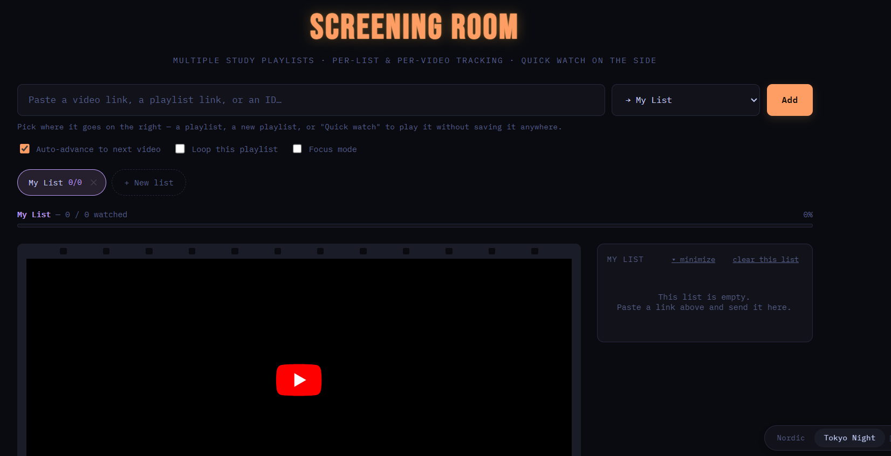
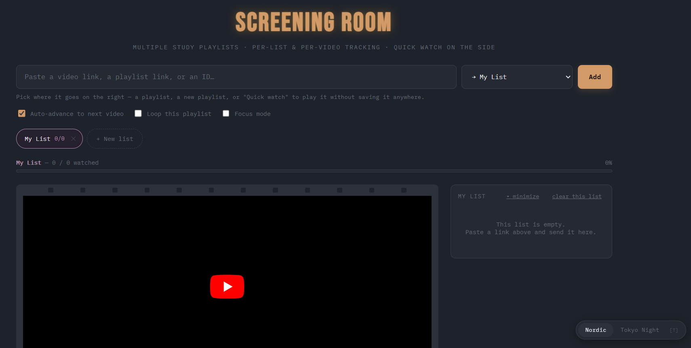

# Distraction-Free YouTube Player

A browser-based YouTube player focused on watching from personal queues instead of browsing the recommendation feed.




## Features

- Add individual YouTube videos by URL or 11-character video ID.
- Import an accessible YouTube playlist into a local queue.
- Organize videos into named playlists and a separate Quick Watch mode.
- Track completion and playback position in browser storage.
- Jump to a timestamp using seconds, `MM:SS`, or `HH:MM:SS`.
- Use theater mode, fullscreen, focus mode, and light/dark themes.

## Run locally

Open `index.html` in a modern browser. The player uses the YouTube IFrame Player API and YouTube oEmbed to load playback and titles, so an internet connection is required for those features.

Playlists and viewing progress are stored in the browser's `localStorage`; they are local to that browser profile and are not synchronized to an account.

## Input formats

Video input accepts a raw 11-character video ID or a YouTube watch, short-link, Shorts, embed, or live URL. Playlist import accepts a YouTube URL containing a `list` parameter.

Timestamp jumps accept non-negative seconds, `MM:SS`, or `HH:MM:SS`. Seconds fields must be between 00 and 59 in clock-form timestamps.

## Tests

The URL and timestamp parsing helpers are isolated in `player-utils.js`.

Requirements: Node.js 18 or newer.

Run the built-in test suite:

```bash
node --test
```
